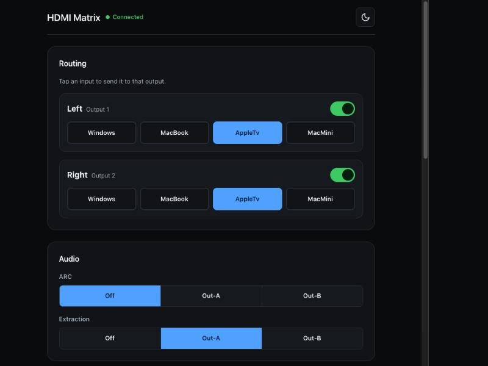
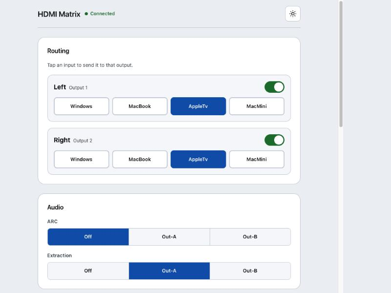

# HDMI Matrix

[](https://github.com/scotchnhand/hdmi-matrix-control/actions/workflows/ci.yml)
[](https://github.com/scotchnhand/hdmi-matrix-control/actions/workflows/codeql.yml)
[](LICENSE)

A modern control surface for a generic 4-input / 2-output HDMI matrix
switcher — the kind of cheap, white-label AV-over-HDMI box with a circa-2015
embedded web UI and no public API documentation. This repo replaces that UI
with two things, both talking directly to the matrix over your LAN (no
cloud, no vendor app):

| | |
|---|---|
| **[`hdmi-matrix-ui/`](hdmi-matrix-ui/)** | A local web app — zero-dependency Python backend + a dark-mode, high-contrast, installable-as-a-PWA frontend |
| **[`ha-hdmi-matrix/`](ha-hdmi-matrix/)** | A Home Assistant custom integration — `select`/`switch`/`button`/`sensor` entities for routing, power, and EDID |
| **[`ios-app/`](ios-app/)** | A native SwiftUI iPhone/iPad app (iOS 26, Liquid Glass) that talks to the matrix directly — no backend needed. [User guide](docs/ios-guide/README.md) |

<p align="center">
  
  
</p>

## Why this exists

The matrix's own web UI is a single unauthenticated-feeling HTML page from
2015, with no mobile layout, no dark mode, and a routing model (tiny
checkboxes + an "ON"/"OFF" text button) that's miserable to use from a
couch. It also has **no public API** — everything here was built by
reverse-engineering its actual wire protocol (JSONP-ish polling + raw POST
commands). That protocol is fully documented in
**[docs/PROTOCOL.md](docs/PROTOCOL.md)**.

## Quick start

**Web app:**

```bash
cd hdmi-matrix-ui/backend
cp config.example.json config.json   # edit host/username/password
python3 server.py
```

Open `http://localhost:8765` (or your LAN IP, printed on startup) and
optionally "Add to Home Screen" on your phone. See
[hdmi-matrix-ui/README.md](hdmi-matrix-ui/README.md) for the mock-mode
preview (no hardware required) and full config options.

**Home Assistant:**

Install through HACS as a custom repository, or unzip `hdmi_matrix.zip`
from the [latest release](https://github.com/scotchnhand/hdmi-matrix-control/releases/latest)
into your HA config's `custom_components/hdmi_matrix/`. Restart HA, then Settings → Devices & Services → Add
Integration → "HDMI Matrix". See
[ha-hdmi-matrix/README.md](ha-hdmi-matrix/README.md) for the full entity
list and why this uses direct IP instead of Matter.

## Repo structure

```
hdmi-matrix-ui/        Local web app (backend/ + frontend/), own README
ha-hdmi-matrix/         Home Assistant integration, own README
ios-app/                Native SwiftUI app + MatrixKit Swift package, own README
docs/
  PROTOCOL.md           The matrix's reverse-engineered wire protocol
  ROADMAP.md             What's done, planned, and deliberately rejected
  DEVELOPMENT.md          Dev setup, testing, branch/commit conventions
.github/
  workflows/              CI (lint + test + coverage), CodeQL, dependabot.yml
  ISSUE_TEMPLATE/          Bug report / feature request forms
  PULL_REQUEST_TEMPLATE.md
CONTRIBUTING.md
LICENSE                  MIT
```

## Development, testing, and contributing

Both subprojects have a real test suite (protocol parsing against captured
real-device responses, plus an in-process HTTP server test for the web
app) that runs in CI on every push/PR, alongside linting, Home Assistant
manifest validation, weekly CodeQL scanning, and Dependabot. See
**[docs/DEVELOPMENT.md](docs/DEVELOPMENT.md)** for how to run everything
locally, and **[CONTRIBUTING.md](CONTRIBUTING.md)** / the issue templates
for filing bugs and feature requests. **[docs/ROADMAP.md](docs/ROADMAP.md)**
tracks what's planned next (and why a few things, like Matter support,
were deliberately ruled out).

## A hardware note

This class of matrix has a fragile, single-threaded embedded HTTP server
that can lock up under rapid or concurrent requests. If either client
shows "connection lost" and stays that way, power-cycle the matrix
(unplug/replug) — no settings are lost. Both `matrix_client.py`
implementations serialize requests to the device specifically to minimize
this. Details in [docs/PROTOCOL.md](docs/PROTOCOL.md).

## License

[MIT](LICENSE)
