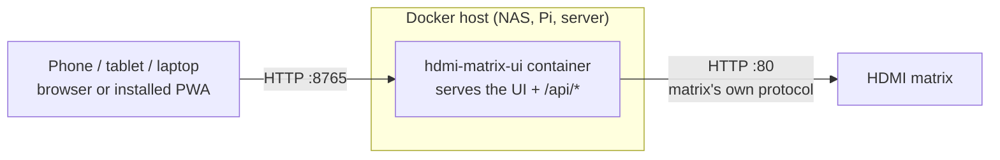

# Deploying the Web App with Docker

This guide covers running the HDMI Matrix web app (`hdmi-matrix-ui/`) as a
Docker container: with the Docker CLI, Docker Compose, **Portainer**, and
**ZimaOS** (the same steps work on CasaOS).

- [How it works](#how-it-works)
- [Before you start](#before-you-start)
- [The image](#the-image)
- [Configuration](#configuration)
- [Docker CLI](#docker-cli)
- [Docker Compose](#docker-compose)
- [Portainer](#portainer)
- [ZimaOS](#zimaos)
- [Check that it works](#check-that-it-works)
- [Installing on phones and tablets](#installing-on-phones-and-tablets)
- [Behind a reverse proxy](#behind-a-reverse-proxy)
- [Security](#security)
- [Updating and rolling back](#updating-and-rolling-back)
- [Troubleshooting](#troubleshooting)
- [Building the image yourself](#building-the-image-yourself)

## How it works



The matrix's built-in web server sends no CORS headers, so a browser can't
call it from another page. The container serves the web app and proxies
its `/api/*` calls to the matrix. The container needs to reach the matrix
on port 80, and your devices need to reach the container.

## Before you start

You need:

1. **A Docker host on the same LAN as the matrix.** Any always-on amd64
   or arm64 machine works: a NAS, a ZimaBoard/ZimaCube, a Raspberry Pi
   running a 64-bit OS, or a home server.
2. **The matrix's IP address.** Find it in your router's DHCP client list,
   or open `http://matrix.local` from a computer and read it from the
   network settings page. **Give the matrix a DHCP reservation** in your
   router so the address never changes.
3. **The matrix's web login.** The factory default is `admin` / `admin`.

> [!IMPORTANT]
> Use the matrix's **IP address**, not `matrix.local`. `.local` names use
> mDNS, which containers on Docker's default bridge network can't resolve.
> The app's built-in default is `matrix.local`, so you must set
> `MATRIX_HOST` when running in Docker.

## The image

Each release publishes a public, multi-arch image to the GitHub Container
Registry:

```text
ghcr.io/scotchnhand/hdmi-matrix-control
```

| Tag | Meaning |
|---|---|
| `latest` | Newest release. Moves on every release. |
| `dev` | Latest image built from the `dev` branch. May change at any time. |
| `1.2` | Newest patch release of 1.2.x. |
| `1.2.0` | One exact release. Never changes. |

Platforms: `linux/amd64` and `linux/arm64`. There is no 32-bit ARM
(`armv7`) build; on a Raspberry Pi, use a 64-bit OS.

Release tags are listed on the
[Releases page](https://github.com/scotchnhand/hdmi-matrix-control/releases).
Pin an exact tag (for example `1.2.0`) if you want upgrades only when you
choose them.

The image:

- runs the standard-library Python server as a non-root user;
- listens on port **8765** inside the container;
- has a built-in health check that requests the app's start page. It
  never polls the matrix, whose embedded web server is fragile;
- stops cleanly on `docker stop`.

## Configuration

Configure the container with environment variables:

| Variable | Required | Default | Description |
|---|---|---|---|
| `MATRIX_HOST` | **Yes** | `matrix.local` | Matrix IP address (or hostname the container can resolve). `mock` runs a built-in demo matrix. |
| `MATRIX_USERNAME` | No | `admin` | Matrix web login username. |
| `MATRIX_PASSWORD` | No | `admin` | Matrix web login password. |
| `API_TOKEN` | No | *(empty)* | If set, control requests must send a matching `X-API-Token` header. The web app asks for it once per browser. See [Security](#security). Available in releases after 1.2.0. |
| `LISTEN_PORT` | No | `8765` | Port inside the container. Leave it alone and change the *published* port instead. |
| `LISTEN_HOST` | No | `0.0.0.0` | Bind address inside the container. Leave it alone. |

To use a different port on the host, change only the left side of the port
mapping, for example `-p 8080:8765`.

### Using a config file instead

You can mount a JSON file at `/app/backend/config.json` instead of setting
the matrix variables:

```json
{
  "matrix_host": "192.168.1.100",
  "matrix_username": "admin",
  "matrix_password": "admin"
}
```

```bash
docker run -d --name hdmi-matrix-ui -p 8765:8765 \
  -v /path/to/config.json:/app/backend/config.json:ro \
  ghcr.io/scotchnhand/hdmi-matrix-control:latest
```

Things to know:

- Environment variables take precedence over the file.
- The image sets `LISTEN_HOST` and `LISTEN_PORT`, so `listen_host` and
  `listen_port` in the file have no effect in Docker.
- The container runs as an unprivileged user, so the file must be
  world-readable (`chmod 644 config.json`).

### After changing matrix network or password settings

The web app applies an accepted network or password change to its running
matrix client. To keep it working after the container restarts, update the
matching `MATRIX_HOST`, `MATRIX_USERNAME`, and `MATRIX_PASSWORD` environment
values, or the `matrix_host`, `matrix_username`, and `matrix_password` fields
in the mounted `config.json`, then recreate the container. The app does not
write credentials submitted in the web form to Docker settings or config files.

### Demo mode

`MATRIX_HOST=mock` runs against an in-memory fake matrix. Use it to try the
UI or test your setup before pointing it at the real device:

```bash
docker run --rm -p 8765:8765 -e MATRIX_HOST=mock \
  ghcr.io/scotchnhand/hdmi-matrix-control:latest
```

## Docker CLI

```bash
docker run -d \
  --name hdmi-matrix-ui \
  --restart unless-stopped \
  -p 8765:8765 \
  -e MATRIX_HOST=192.168.1.100 \
  -e MATRIX_USERNAME=admin \
  -e MATRIX_PASSWORD=admin \
  ghcr.io/scotchnhand/hdmi-matrix-control:latest
```

Replace `192.168.1.100` with your matrix's IP address. Then open
`http://<docker-host-ip>:8765`.

## Docker Compose

The repository includes
[`hdmi-matrix-ui/docker-compose.yml`](../hdmi-matrix-ui/docker-compose.yml):

```yaml
services:
  hdmi-matrix-ui:
    image: ghcr.io/scotchnhand/hdmi-matrix-control:${HDMI_MATRIX_TAG:-latest}
    container_name: hdmi-matrix-ui
    restart: unless-stopped
    ports:
      - "${HDMI_MATRIX_PORT:-8765}:8765"
    environment:
      MATRIX_HOST: ${MATRIX_HOST:-192.168.1.100}
      MATRIX_USERNAME: ${MATRIX_USERNAME:-admin}
      MATRIX_PASSWORD: ${MATRIX_PASSWORD:-admin}
      # Optional: require an X-API-Token header on state-changing requests.
      API_TOKEN: ${API_TOKEN:-}
```

Put your settings in a `.env` file next to it, so you don't edit the
compose file and your password stays out of version control:

```dotenv
MATRIX_HOST=192.168.1.100
MATRIX_USERNAME=admin
MATRIX_PASSWORD=admin
# Optional
# HDMI_MATRIX_TAG=1.2.0
# HDMI_MATRIX_PORT=8765
# API_TOKEN=change-me
```

Start it:

```bash
docker compose up -d
```

## Portainer

These steps use Portainer CE 2.x. You can deploy as a **stack** (a compose
file, recommended) or as a single **container**.

### Option A: Stack from the web editor (recommended)

1. In Portainer, select your environment (usually **local**).
2. Go to **Stacks** → **+ Add stack**.
3. **Name:** `hdmi-matrix-ui` (lowercase letters, digits, `-` and `_` only).
4. **Build method:** **Web editor**. Paste:

   ```yaml
   services:
     hdmi-matrix-ui:
       image: ghcr.io/scotchnhand/hdmi-matrix-control:${HDMI_MATRIX_TAG:-latest}
       container_name: hdmi-matrix-ui
       restart: unless-stopped
       ports:
         - "${HDMI_MATRIX_PORT:-8765}:8765"
       environment:
         MATRIX_HOST: ${MATRIX_HOST}
         MATRIX_USERNAME: ${MATRIX_USERNAME:-admin}
         MATRIX_PASSWORD: ${MATRIX_PASSWORD:-admin}
         API_TOKEN: ${API_TOKEN:-}
   ```

5. Under **Environment variables**, click **+ Add an environment variable**
   for each setting (or **Advanced mode** to paste them as `KEY=value`
   lines):

   | Name | Value |
   |---|---|
   | `MATRIX_HOST` | your matrix's IP, for example `192.168.1.100` |
   | `MATRIX_USERNAME` | `admin` |
   | `MATRIX_PASSWORD` | your matrix password |

   Optionally add `HDMI_MATRIX_TAG` (for example `1.2.0`),
   `HDMI_MATRIX_PORT`, or `API_TOKEN`.

6. Click **Deploy the stack**.
7. Open `http://<docker-host-ip>:8765`.

### Option B: Stack from the Git repository

Portainer can read the compose file straight from GitHub, and can
redeploy when it changes.

1. **Stacks** → **+ Add stack**, name it `hdmi-matrix-ui`.
2. **Build method:** **Repository**.
3. **Repository URL:** `https://github.com/scotchnhand/hdmi-matrix-control`
4. **Repository reference:** `refs/heads/main`
5. **Compose path:** `hdmi-matrix-ui/docker-compose.yml`
6. Leave authentication off; the repository is public.
7. Add the environment variables from step 5 of Option A. They override the
   placeholders in the compose file.
8. Click **Deploy the stack**.

### Option C: Single container

1. Go to **Containers** → **+ Add container**.
2. **Name:** `hdmi-matrix-ui`
3. **Image:** `ghcr.io/scotchnhand/hdmi-matrix-control:latest` (registry
   **Docker Hub** is fine for a fully qualified name; or pick an anonymous
   `ghcr.io` registry if you've added one). Turn **Always pull the image**
   on.
4. **Network ports configuration** → **+ Publish a new network port**:
   host `8765`, container `8765`, TCP.
5. Under **Advanced container settings**:
   - **Env** tab → **+ Add environment variable** for `MATRIX_HOST`,
     `MATRIX_USERNAME`, and `MATRIX_PASSWORD`.
   - **Restart policy** tab → **Unless stopped**.
6. Click **Deploy the container**.

### Updating in Portainer

- **Stack:** open the stack → **Editor** → **Update the stack**, with
  **Re-pull image and redeploy** turned on. For a repository stack, click
  **Pull and redeploy**.
- **Container:** open the container → **Recreate**, with **Re-pull image**
  turned on.

If you pinned a tag, change `HDMI_MATRIX_TAG` (or the image tag) to the new
release and update the stack.

> [!NOTE]
> Portainer shows environment variables, including `MATRIX_PASSWORD`, to
> anyone who can open the stack or container. Limit Portainer access
> accordingly.

## ZimaOS

ZimaOS (and CasaOS) can install any Docker image as a **custom app**. These
steps were written against ZimaOS 1.x; labels may differ slightly between
versions.

### Option A: Import the compose file (recommended)

The repository includes
[`hdmi-matrix-ui/docker-compose.zimaos.yml`](../hdmi-matrix-ui/docker-compose.zimaos.yml).
It carries ZimaOS app metadata, so the app gets a name, icon, and a
working **Open** button on the dashboard.

1. Open the ZimaOS dashboard and go to **App Store**.
2. Click **+** (top right) → **Install a customized app**.
3. Click **Import** (top right of the dialog).
4. Paste the contents of `docker-compose.zimaos.yml`, or upload the file,
   and click **Submit**.
5. ZimaOS fills in the form. Check these fields:
   - **Docker Image:** The imported value defaults to
     `ghcr.io/scotchnhand/hdmi-matrix-control:latest`. To use the dev image,
     replace the full value with
     `ghcr.io/scotchnhand/hdmi-matrix-control:dev` before installing.
   - **Environment variables:** set `MATRIX_HOST` to your matrix's IP.
     Change `MATRIX_USERNAME` and `MATRIX_PASSWORD` if you changed the
     matrix login. Leave `API_TOKEN` empty unless you want one.
   - **Ports:** host `8765` → container `8765`. If ZimaOS reports the port
     is in use, change the **host** side (for example `8766`) and the **Web
     UI** port to match.
6. Click **Install**.
7. When the tile on the dashboard shows the app as running, click it to
   open the web app.

### Option B: Fill in the form by hand

1. **App Store** → **+** → **Install a customized app**.
2. Fill in:

   | Field | Value |
   |---|---|
   | **Docker Image** | `ghcr.io/scotchnhand/hdmi-matrix-control` |
   | **Tag** | `latest`, `dev`, or an exact release such as `1.2.0` |
   | **Title** | `HDMI Matrix` |
   | **Icon URL** | `https://raw.githubusercontent.com/scotchnhand/hdmi-matrix-control/main/hdmi-matrix-ui/frontend/icons/icon-512.png` |
   | **Web UI** | `http://` · *(leave host blank)* · port `8765` · path `/` |
   | **Network** | `bridge` |
   | **Ports** | Host `8765`, Container `8765`, TCP |
   | **Volumes** | none needed |
   | **Environment Variables** | `MATRIX_HOST` = your matrix's IP; `MATRIX_USERNAME` = `admin`; `MATRIX_PASSWORD` = your password |
   | **Restart Policy** | `unless-stopped` |

3. Click **Install**.

### Updating in ZimaOS

ZimaOS doesn't automatically update custom apps. To move to another release
or dev build:

1. On the dashboard, open the app tile's **⋮** menu → **Settings**.
2. Choose the image version:
   - For an imported Compose app, change **Docker Image** to
     `ghcr.io/scotchnhand/hdmi-matrix-control:dev`,
     `ghcr.io/scotchnhand/hdmi-matrix-control:latest`, or a full
     versioned image such as `ghcr.io/scotchnhand/hdmi-matrix-control:1.2.1`.
   - For an app created with the manual form, change **Tag** to `dev`,
     `latest`, or the release number (for example `1.2.1`).
3. Click **Save**. ZimaOS pulls the new image and recreates the container.

Pinning an exact release tag makes this predictable. With `latest`, saving
the settings may not re-pull an image ZimaOS already has.

### ZimaOS notes

- No volumes are required. The app keeps no data of its own; all state
  lives on the matrix.
- If you'd rather use a config file, put it under
  `/DATA/AppData/hdmi-matrix-ui/config.json`, `chmod 644` it, and add a
  volume mapping that file to `/app/backend/config.json`.
- To install from the ZimaOS terminal or SSH instead, copy
  `docker-compose.zimaos.yml` to the box, edit it, and run
  `docker compose -f docker-compose.zimaos.yml up -d`. The app appears on
  the dashboard either way.

## Check that it works

1. **Container health.** `docker ps` should show the container as
   `(healthy)` within about 30 seconds. Portainer shows a green **healthy**
   badge; ZimaOS shows the app as running.
2. **Logs.** `docker logs hdmi-matrix-ui` should start with:

   ```text
   HDMI Matrix UI 1.2.0 serving on:
     http://localhost:8765
     http://172.17.0.2:8765  (use this from your phone/tablet on the same network)
   Proxying to matrix at http://192.168.1.100
   ```

   The `172.17.x.x` address is the container's internal address. Use your
   **Docker host's** LAN IP from other devices.

3. **Matrix connection.** From any machine on the LAN:

   ```bash
   curl http://<docker-host-ip>:8765/api/state
   ```

   A JSON document with inputs and outputs means the container can reach
   the matrix. A `502` with an `error` message means it can't; see
   [Troubleshooting](#troubleshooting).

4. **The UI.** Open `http://<docker-host-ip>:8765` and switch a route.

## Installing on phones and tablets

Open `http://<docker-host-ip>:8765` on the device and use the browser's
**Add to Home Screen** (Safari: Share → Add to Home Screen; Chrome:
⋮ → Add to Home screen / Install app). It then opens full-screen like a
native app.

Over plain `http://` on a LAN IP, browsers don't register the service
worker, so the app shell isn't cached offline. Everything else works. For
offline caching and the full install experience, serve the app over HTTPS
through a [reverse proxy](#behind-a-reverse-proxy).

## Behind a reverse proxy

You can put the app behind Nginx Proxy Manager, Traefik, Caddy, or plain
nginx, for example to serve it over HTTPS at `https://matrix.home.example`.

> [!IMPORTANT]
> The proxy must **pass the original `Host` header** through. The app
> rejects control requests whose `Origin` doesn't match `Host` (this blocks
> cross-site request forgery), so a proxy that rewrites `Host` makes every
> button fail with **403 Cross-origin request rejected**.

Nginx Proxy Manager, Traefik, and Caddy pass `Host` through by default.
For plain nginx, set it explicitly:

```nginx
location / {
    proxy_pass http://127.0.0.1:8765;
    proxy_set_header Host $host;
}
```

Caddy:

```caddyfile
matrix.home.example {
    reverse_proxy 127.0.0.1:8765
}
```

Traefik labels (add to the compose service, and drop the `ports:` mapping
if only Traefik should reach it):

```yaml
    labels:
      - traefik.enable=true
      - traefik.http.routers.hdmi-matrix.rule=Host(`matrix.home.example`)
      - traefik.http.services.hdmi-matrix.loadbalancer.server.port=8765
```

## Security

- **There is no login.** Anyone who can reach the port can control the
  matrix, including reboot, factory reset, and changing its network
  settings. Run it only on a trusted home LAN.
- **Don't expose it to the internet** with a port forward. For remote
  access, use a VPN (WireGuard, Tailscale) or a reverse proxy that adds
  real authentication.
- **CSRF protection is built in.** Control requests must be JSON and
  same-origin, so a malicious web page can't send commands through your
  browser.
- **Optional API token.** Set `API_TOKEN` to require an `X-API-Token`
  header on every control request. The web app asks for the token once
  and remembers it in that browser. Reading state doesn't need it. This
  is available in releases after 1.2.0.
- **Credentials.** `MATRIX_PASSWORD` is visible through `docker inspect`
  and in Portainer and ZimaOS. Keep compose `.env` files out of version
  control. Consider changing the matrix's default `admin` password.

## Updating and rolling back

With the CLI:

```bash
docker pull ghcr.io/scotchnhand/hdmi-matrix-control:latest
docker rm -f hdmi-matrix-ui
# then re-run the docker run command from above
```

With Compose:

```bash
docker compose pull
docker compose up -d
```

To roll back, set the tag to the previous release (for example
`HDMI_MATRIX_TAG=1.2.0`) and run `docker compose up -d`. The container
holds no data, so updating or rolling back loses nothing.

## Troubleshooting

### The UI shows "Connection lost", or `/api/state` returns 502

The container can't reach the matrix.

1. Check `MATRIX_HOST` is the matrix's **IP address**, not `matrix.local`.
2. Test from inside the container:

   ```bash
   docker exec hdmi-matrix-ui python -c "import urllib.request; print(urllib.request.urlopen('http://192.168.1.100/', timeout=5).status)"
   ```

   `200` means the network path is fine; check the username and password.
   A timeout means the Docker host can't reach that IP (wrong address,
   different VLAN, or a firewall).
3. Confirm the matrix answers at all: open `http://<matrix-ip>` in a
   browser.
4. If the matrix's own page doesn't load either, its web server has
   probably locked up. Power-cycle the matrix (unplug it, wait a few
   seconds, plug it back in). No settings are lost. Avoid running several
   clients (the web app, Home Assistant, the iOS app) that poll it
   aggressively at the same time.

### Buttons fail with "Cross-origin request rejected" (403)

A reverse proxy is changing the `Host` header. See
[Behind a reverse proxy](#behind-a-reverse-proxy).

### Buttons fail with "Missing or invalid API token" (401)

`API_TOKEN` is set and the browser has no token or the wrong one. Reload
the page and enter the token when asked.

### `exec format error` in the logs

The host is 32-bit ARM. Only `amd64` and `arm64` images are published.
Install a 64-bit OS, or [build the image yourself](#building-the-image-yourself)
on the device.

### "Port is already allocated" / port in use

Another service uses 8765 on the host. Publish a different host port, for
example `-p 8766:8765`, and browse to that port.

### The container shows as unhealthy

The health check requests `http://127.0.0.1:8765/` inside the container.
Check `docker logs hdmi-matrix-ui` for a startup error. If you changed
`LISTEN_PORT`, change it back; remap the published port instead.

### The logs show a request every 30 seconds

Those are the health check's requests to `/`. They don't touch the matrix.

## Building the image yourself

```bash
git clone https://github.com/scotchnhand/hdmi-matrix-control.git
cd hdmi-matrix-control/hdmi-matrix-ui
docker build -t hdmi-matrix-ui:local .
docker run -d --name hdmi-matrix-ui -p 8765:8765 \
  -e MATRIX_HOST=192.168.1.100 hdmi-matrix-ui:local
```

For other platforms, use Buildx, for example
`docker buildx build --platform linux/arm/v7 -t hdmi-matrix-ui:armv7 --load .`.
Release images are built by `.github/workflows/release.yml`; see
[DEVELOPMENT.md](DEVELOPMENT.md#releases).
