# HDMI Matrix for iOS — User Guide

This guide covers everything the iPhone and iPad app does, one screen at a
time. Every screenshot here is captured automatically by the app's UI tests
against the built-in demo matrix (see [Keeping this guide current](#keeping-this-guide-current)),
so what you see matches the app.

**Contents**

1. [Installing the app](#1-installing-the-app)
2. [First launch and demo mode](#2-first-launch-and-demo-mode)
3. [Connecting to your matrix](#3-connecting-to-your-matrix)
4. [Routing: choosing what each screen shows](#4-routing-choosing-what-each-screen-shows)
5. [Turning outputs on and off](#5-turning-outputs-on-and-off)
6. [Audio: ARC and extraction](#6-audio-arc-and-extraction)
7. [Renaming inputs and outputs](#7-renaming-inputs-and-outputs)
8. [Inputs and EDID](#8-inputs-and-edid)
9. [The Device tab](#9-the-device-tab)
10. [Rebooting and factory reset](#10-rebooting-and-factory-reset)
11. [Connection status and troubleshooting](#11-connection-status-and-troubleshooting)

---

## 1. Installing the app

The app isn't on the App Store; you build it from this repository with a
Mac.

**You need:** a Mac with **Xcode 26 or later**, and an iPhone or iPad on
**iOS 26 or later**, on the same network as the matrix.

1. Open `ios-app/HDMIMatrix.xcodeproj` in Xcode.
2. To try it without a phone, pick any iPhone simulator in the toolbar and
   press **⌘R**. The app opens in demo mode; you can skip to
   [section 2](#2-first-launch-and-demo-mode).
3. To install on your own device:
   1. Select the **HDMIMatrix** target → **Signing & Capabilities**, and
      choose your Apple ID under **Team**. A free Apple ID works, but the app
      then expires after 7 days and needs re-running from Xcode.
   2. Connect the phone with a cable. On the phone, turn on **Settings →
      Privacy & Security → Developer Mode** (it restarts).
   3. Choose the phone in Xcode's toolbar and press **⌘R**. The first time,
      trust the developer on the phone under **Settings → General → VPN &
      Device Management**.

## 2. First launch and demo mode

The app always starts in **demo mode**, which uses a simulated matrix
with no hardware. Use it to look around and try everything safely; nothing you do in
demo mode touches a real device.

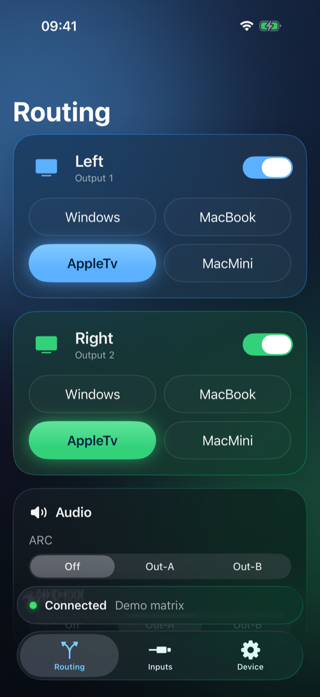

The app has three tabs along the bottom:

| Tab | What it's for |
|---|---|
| **Routing** | What each screen shows, output power, and audio |
| **Inputs** | Input names and EDID (what each source is told to send) |
| **Device** | Connection settings, device info, network, password, reboot |

The bar just above the tabs always shows the **connection status**: a
green dot means connected, orange means connecting, red means the app
can't reach the matrix. It shrinks out of the way as you scroll.

## 3. Connecting to your matrix

1. Go to the **Device** tab and tap the **Connection** row at the top.
2. Turn **Demo mode** off.
3. Enter the matrix's **Host**: `matrix.local`, or its IP address (for
   example `192.168.1.168`). If you paste a full address like
   `http://192.168.1.168/`, the app tidies it up for you.
4. Enter the matrix's **Username** and **Password** (the factory default
   is `admin` / `admin`).
5. Tap **Save**.

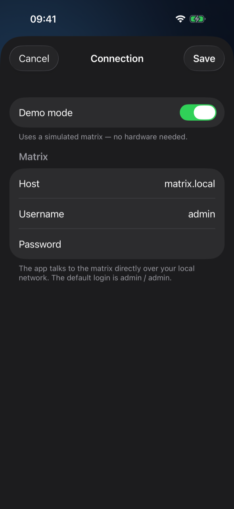

On a real phone, iOS asks once whether the app can find devices on your
**local network**. Choose **Allow**, or the app can't reach the matrix.
If you chose Don't Allow by mistake, turn it back on in **Settings →
Privacy & Security → Local Network → HDMI Matrix**.

The password is stored in the iOS Keychain, not in plain settings.

## 4. Routing: choosing what each screen shows

Each output (each screen connected to the matrix) has its own card on
the **Routing** tab. Output 1 is always **blue** and output 2 is always
**green**, matching the app icon.

To change what a screen shows, **tap an input**. The highlighted pill
slides to your choice and the matrix switches right away; you'll feel a
light tap of haptic feedback.

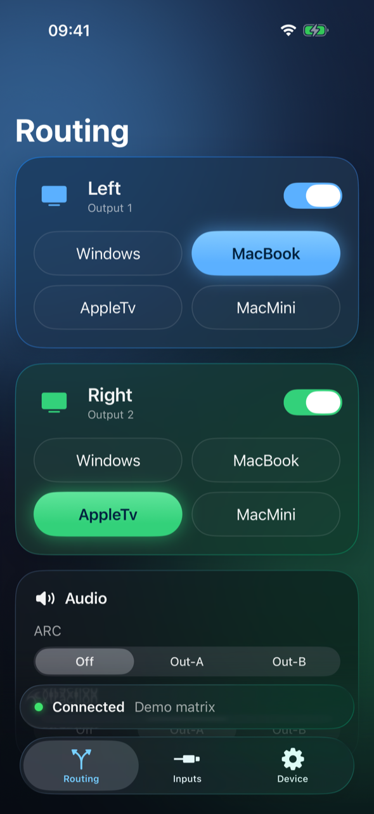

The same input can go to both screens at once (the demo starts with
AppleTv on both).

The app refreshes from the matrix every 3 seconds, so if someone changes
the routing from the matrix's own web page or remote, the app catches up
on its own. Pull down on the list to refresh immediately.

## 5. Turning outputs on and off

Use the switch at the top right of an output's card to turn that HDMI
output on or off. While an output is off its inputs are greyed out and
can't be tapped, and the card tells you why:

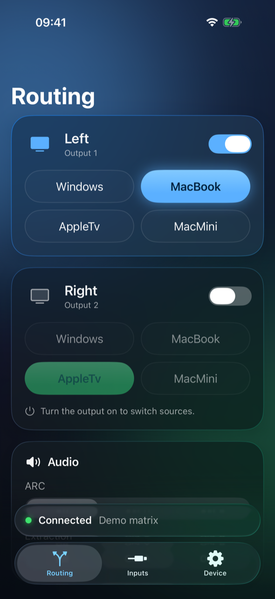

Turn it back on to choose sources again. The matrix remembers which
input was selected.

## 6. Audio: ARC and extraction

Scroll down the **Routing** tab to the **Audio** card.

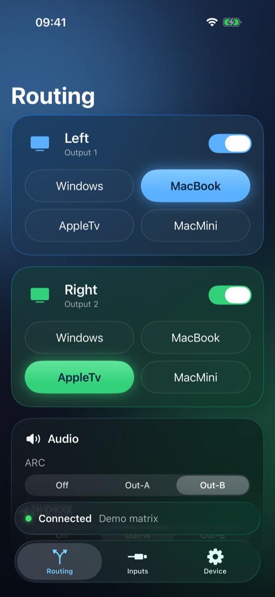

- **ARC** (Audio Return Channel) picks which output's TV sends its audio
  back to the matrix, typically for a soundbar or receiver connected via
  ARC. Choose **Off**, **Out-A** (output 1) or **Out-B** (output 2).
- **Extraction** picks which output's audio is sent to the matrix's
  separate audio-out port (optical/analog). Same choices.

## 7. Renaming inputs and outputs

Tap any **name** to rename it: an output's name on the Routing tab, or an
input's name on the Inputs tab.

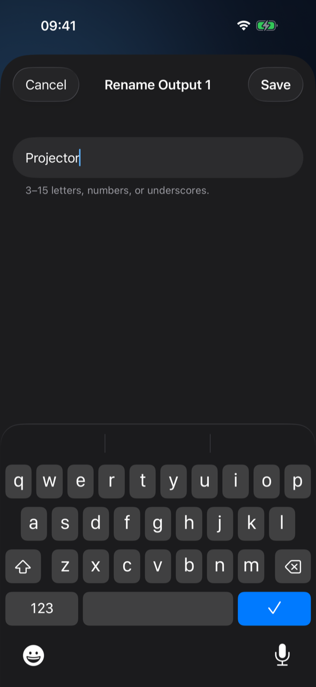

Names must be **3–15 characters**, using only **letters, numbers and
underscores** (the matrix's own rule), so `Living_Room` works but
`Living Room` doesn't. **Save** stays disabled until the name is valid.
New names are stored on the matrix itself, so they show up in the web
app and Home Assistant too.

## 8. Inputs and EDID

The **Inputs** tab lists the four inputs. Small colored tags show which
screens each input is currently live on.

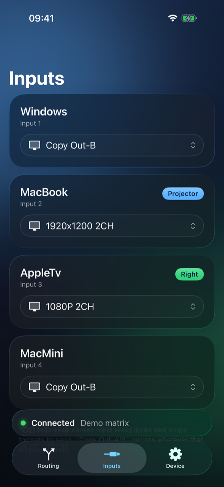

**EDID** is the information a display sends to a source to say what it
supports (resolutions, HDR, audio channels). The matrix sits in between,
so it tells each source what to send. Tap an input's EDID button to choose
a preset:

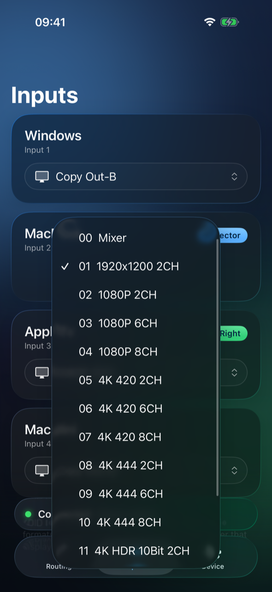

| Preset | Use it when |
|---|---|
| **1080P / 1920x1200** | Your displays are HD and you want maximum compatibility |
| **4K 420 / 4K 444** | Your displays are 4K; 444 is sharper text (e.g. a computer), 420 needs less bandwidth |
| **4K HDR 10Bit** | You want HDR from a streaming box or console, and both displays support it |
| **2CH / 6CH / 8CH** | Stereo / 5.1 / 7.1 audio, depending on your speakers |
| **Copy Out-A / Copy Out-B** | Pass through exactly what that display reports (a good default with one main TV) |
| **Mixer** | The matrix's own combined profile, based on what both displays report |

If a source shows a black screen or no sound after switching, try a more
conservative preset (1080P 2CH), then work your way up. Under the
button, the app shows the mode the matrix actually negotiated, when the
device reports it.

## 9. The Device tab

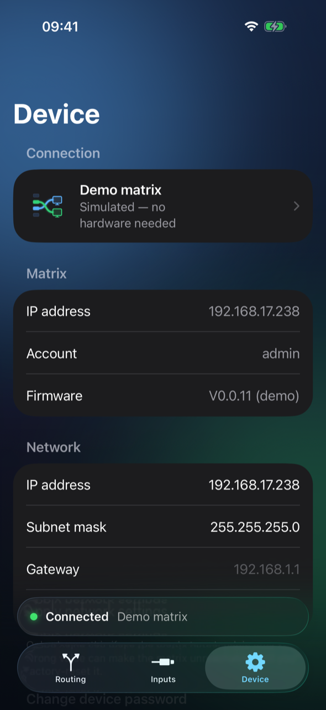

- **Connection**: which matrix the app talks to (tap to change, see
  [section 3](#3-connecting-to-your-matrix)).
- **Matrix**: the device's IP address, account and firmware version.
- **Network**: gives the matrix a new static IP address, subnet mask and
  gateway. You confirm first; the matrix then restarts its network, and
  the app **automatically follows it to the new address**. Only change
  this if you know your network: a wrong value can make the matrix
  unreachable until you factory-reset it.
- **Change device password**: changes the matrix's login. The app
  updates its own saved login to match, so it stays connected.

## 10. Rebooting and factory reset

At the bottom of the Device tab, the **Danger Zone**:

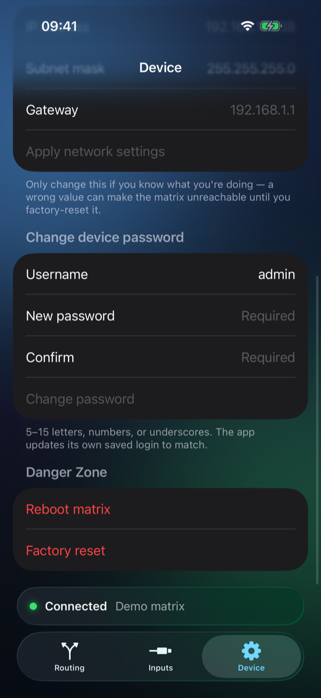

- **Reboot matrix** restarts the matrix (about 15 seconds). The app shows
  **Connecting…** while it's down and reconnects on its own.
- **Factory reset** erases all routing, names, EDID and network settings.
  If the reset also changes the matrix's IP address, update the host
  under **Connection**.

Both ask for confirmation first:

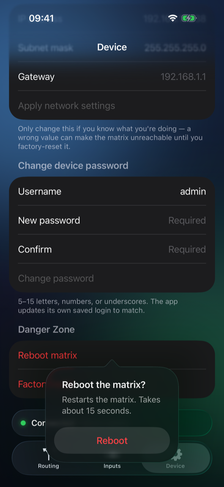

## 11. Connection status and troubleshooting

| You see | What it means / what to do |
|---|---|
| 🟢 **Connected** | All good. |
| 🟠 **Connecting…** | The app is reaching the matrix, or waiting for it to come back after a reboot or network change. |
| 🔴 **Connection lost** | The last request failed. Tap the ↻ button in the status bar to retry. |
| **"Can't reach the matrix"** screen | The app has never connected with these settings. Check the host, and that your phone is on the same Wi-Fi as the matrix. |
| **"Invalid user or password"** | The username/password in Connection settings don't match the matrix. |

**The matrix stops responding entirely?** This model has a fragile,
single-threaded web server that can lock up, while still answering
ping. **Unplug the matrix's power for a few seconds and plug it back in**.
No settings are lost. The app spaces out its requests one at a time to
make this rare.

**Nothing works on a real phone, but demo mode does?** Check Local
Network permission (section 3), and try the matrix's IP address instead
of `matrix.local`. Some routers don't pass `.local` names reliably.

---

## Keeping this guide current

The screenshots come from the `testWalkthrough` UI test, which drives the
app through every step above against the demo matrix and fails if any of
them stops working. CI runs it on every pull request and attaches the
screenshots as an `ios-ui-screenshots` artifact. To refresh the images
here after a UI change:

```bash
ios-app/scripts/capture_screenshots.sh
```
